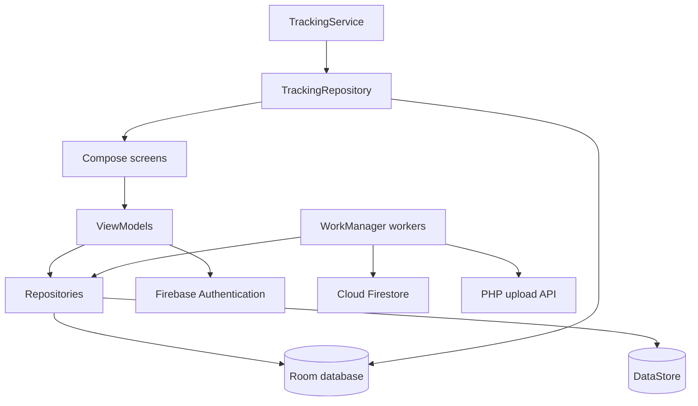
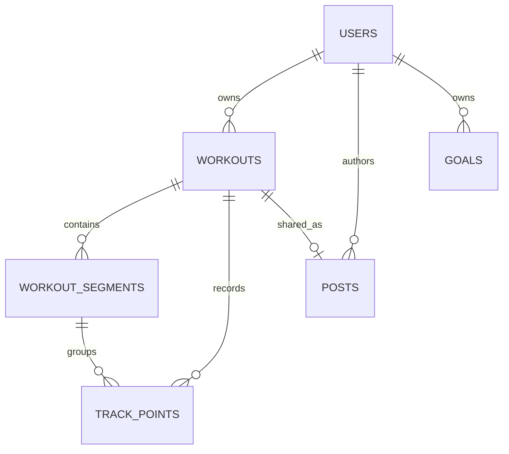
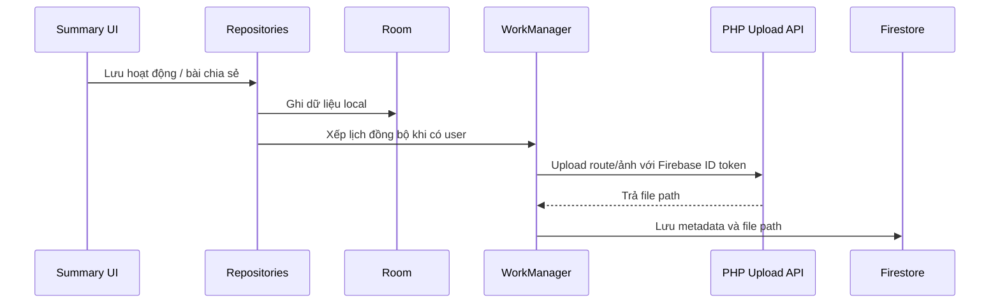
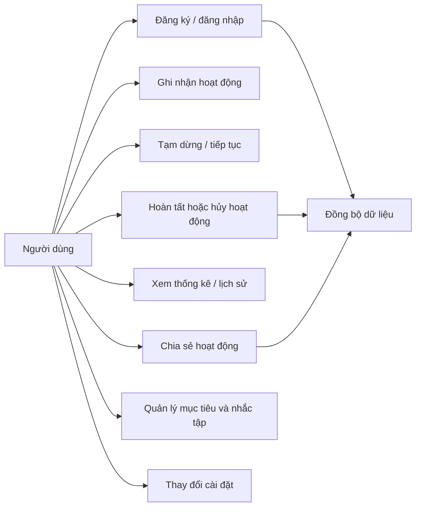

# KaiWalker

KaiWalker là ứng dụng Android ghi nhận hoạt động chạy bộ và đạp xe bằng GPS. Ứng dụng ưu tiên lưu dữ liệu trên thiết bị bằng Room, sau đó đồng bộ hoạt động và bài chia sẻ khi có tài khoản và kết nối mạng. Ảnh và dữ liệu tuyến đường được gửi qua PHP API riêng; Firebase Storage không được sử dụng.

README này mô tả cấu trúc mã nguồn hiện tại để nhóm dùng làm tài liệu báo cáo. Các cấu hình Firebase, Google Maps và PHP API phụ thuộc môi trường triển khai; không đưa khóa riêng hoặc thông tin xác thực vào báo cáo.

## 1. Công nghệ và cấu trúc

- Kotlin, Jetpack Compose và Material 3 cho giao diện.
- Navigation Compose cho các màn hình trong một `MainActivity`.
- MVVM: Compose UI quan sát state từ `ViewModel`; `ViewModel` gọi repository.
- Hilt cho dependency injection.
- Room cho dữ liệu hoạt động, GPS, bài đăng và mục tiêu lưu trên thiết bị.
- DataStore Preferences cho cài đặt ứng dụng.
- Android Location Services và foreground service cho theo dõi GPS liên tục.
- WorkManager cho đồng bộ nền và nhắc tập định kỳ theo lịch không chính xác tuyệt đối.
- Firebase Authentication cho tài khoản; Cloud Firestore lưu metadata hoạt động/bài đăng.
- PHP API lưu và phân phối ảnh, avatar và tệp route; đường dẫn API được cấu hình trong `app/build.gradle.kts`.
- Google Maps Compose hiển thị tuyến đường trong chi tiết hoạt động.



## 2. Tính năng

- Đăng ký, đăng nhập, đăng xuất, khôi phục phiên và đặt lại mật khẩu bằng Firebase Authentication khi Firebase được cấu hình.
- Bắt đầu chạy bộ hoặc đạp xe; xem thời gian, quãng đường, tốc độ/pace và trạng thái GPS.
- Tạm dừng, tiếp tục, hoàn tất hoặc hủy buổi ghi nhận.
- Lưu workout, các đoạn di chuyển và các điểm GPS vào Room; dữ liệu đã lưu có thể xem offline.
- Xem lịch sử, chi tiết hoạt động, tuyến đường trên bản đồ và thông tin từng segment.
- Tạo bài chia sẻ từ hoạt động, thêm mô tả/ảnh và chọn phạm vi hiển thị. Ảnh được tải lên PHP API khi đồng bộ.
- Xem tổng quan tuần và biểu đồ theo ngày cho quãng đường, thời lượng vận động hoặc số buổi.
- Tạo, sửa, xóa mục tiêu tuần theo quãng đường, thời lượng hoặc số buổi; xem tiến độ tính từ hoạt động hoàn tất.
- Chọn ngày/giờ nhắc mục tiêu. WorkManager phát notification nếu quyền thông báo được cấp.
- Tùy chỉnh đơn vị km/dặm, giao diện sáng/tối/theo hệ thống, loại hoạt động mặc định và tự động tạm dừng.
- Cập nhật tên hiển thị và ảnh đại diện tài khoản.

## 3. Activity, service và notification

| Thành phần | Trách nhiệm |
|---|---|
| `MainActivity` | Activity duy nhất được khai báo làm launcher; khởi tạo Compose, theme và `NavGraph`. |
| `NavGraph` | Điều hướng giữa Splash, Login, Register, Home, Record, Profile, Summary và Workout Detail. Đây là destination Compose, không phải các Android Activity riêng. |
| `TrackingService` | Foreground location service giữ việc ghi GPS hoạt động khi ứng dụng xuống nền. Nhận lệnh bắt đầu, tạm dừng, tiếp tục và kết thúc. |
| Notification của tracking | Hiển thị trạng thái hoạt động; có action tạm dừng/tiếp tục, kết thúc và mở ứng dụng. |
| `WorkoutSyncWorker` | Đồng bộ workout, route và post khi có tài khoản; dùng Firebase/Firestore cho metadata và PHP API cho file. |
| `GoalReminderWorker` | Đọc mục tiêu/tiến độ, hiển thị notification nhắc tập rồi nối lịch cho lần tiếp theo. |

Tracking service cần quyền vị trí foreground. Trên Android 13 trở lên, người dùng cần cấp `POST_NOTIFICATIONS` thì notification nhắc mục tiêu mới hiển thị. WorkManager không đảm bảo chạy đúng chính xác phút đã chọn; hệ điều hành có thể trì hoãn để tối ưu pin. Lịch được lưu qua WorkManager và được hệ thống khôi phục sau khởi động lại.

## 4. Model và Entity

Các model trong `data/model` đang được sử dụng trong luồng ứng dụng; model không chỉ được khai báo để minh họa.

| Model | Vai trò và nơi sử dụng |
|---|---|
| `User`, `AuthState` | Thông tin Firebase user và trạng thái khôi phục/đăng nhập/đăng xuất; dùng ở auth, splash, profile và các luồng cần owner ID. |
| `Workout`, `WorkoutType`, `WorkoutStatus`, `WorkoutVisibility`, `SyncStatus` | Nghiệp vụ hoạt động, loại hình, trạng thái, quyền riêng tư và đồng bộ; dùng từ tracking đến Room, UI và Firebase sync. |
| `WorkoutSegment` | Đại diện từng đoạn liên tục giữa các lần tạm dừng; được tạo khi record/resume và hiển thị trong chi tiết hoạt động. |
| `TrackPoint` | Điểm GPS có thứ tự, vị trí, độ chính xác và thời gian; dùng để khôi phục/hiển thị tuyến đường và tải route lên API. |
| `Post` | Metadata bài chia sẻ gắn với workout, ảnh, caption và trạng thái đồng bộ; dùng ở Home, Summary và sync worker. |
| `Goal`, `GoalMetric`, `GoalPeriod`, `GoalReminder`, `GoalProgress` | Mục tiêu, chu kỳ, đơn vị đo, lịch nhắc và tiến độ; dùng trong Profile, repository và worker. Giao diện hiện tạo mục tiêu theo tuần. |
| `WorkoutStatistics`, `DailyWorkoutStatistics` | Tổng hợp số buổi, quãng đường và thời gian; dùng cho thống kê Profile và biểu đồ Home. |
| `TrackingState`, `TrackingStatus`, `GpsStatus` | Snapshot trạng thái GPS/runtime trong RAM, truyền từ tracking repository/service đến giao diện Record. |
| `AppSettings`, `DistanceUnit`, `ThemeMode` | Cài đặt hiển thị và ghi nhận; được SettingsRepository lưu/đọc bằng DataStore. |

`data/local` chứa các Room entity:

| Entity | Bảng | Dữ liệu |
|---|---|---|
| `WorkoutEntity` | `workouts` | Chủ sở hữu, loại/trạng thái, thời gian, quãng đường, quyền riêng tư và sync status. |
| `WorkoutSegmentEntity` | `workout_segments` | Các đoạn di chuyển theo thứ tự trong một workout. |
| `TrackPointEntity` | `track_points` | Các điểm GPS theo thứ tự và theo segment. |
| `PostEntity` | `posts` | Caption, đường dẫn ảnh, workout liên quan và sync status. |
| `GoalEntity` | `goals` | Mục tiêu, chu kỳ, target, owner và cấu hình nhắc tập. |



`USERS` trong sơ đồ là tài khoản Firebase, không phải bảng Room. Các liên kết workout/segment/track/post trong Room hiện được quản lý bằng ID ở repository và DAO; schema không khai báo foreign key SQL. `TrackingState` là state tạm trong bộ nhớ, không phải entity lưu bền vững.

## 5. Database và đồng bộ

`AppDatabase` dùng Room, tên file `kaiwalker.db`, hiện ở schema version 3:

- Migration `1 -> 2`: tạo bảng posts và index.
- Migration `2 -> 3`: tạo bảng goals và index.
- `WorkoutRepository`, `PostRepository` và `GoalRepository` điều phối truy cập DAO và chuyển đổi giữa entity với domain model.
- Thông tin đăng nhập do Firebase Auth quản lý; cài đặt cục bộ lưu trong DataStore.
- Workout/post/route được lưu local trước. Khi có user phù hợp, `SyncScheduler` xếp `WorkoutSyncWorker` vào WorkManager.
- Metadata workout/post được đồng bộ vào các collection con của user trong Firestore. Route và ảnh được chuyển qua PHP API; Firestore giữ đường dẫn tương đối của file.
- Mục tiêu và lịch nhắc hiện lưu local trong Room, chưa đồng bộ giữa thiết bị.



## 6. Use case

**Tác nhân chính:** Người dùng. **Dịch vụ ngoài:** Firebase Authentication, Firestore, PHP Upload API và dịch vụ vị trí Android.



### Đặc tả use case tiêu biểu

| Use case | Luồng chính | Ngoại lệ/kết quả thay thế |
|---|---|---|
| Ghi nhận hoạt động | Chọn chạy bộ/đạp xe, cấp quyền vị trí, bắt đầu service; service lấy GPS, repository lưu workout/segment/track point vào Room. | Thiếu quyền hoặc tắt GPS thì UI báo trạng thái; dữ liệu chưa upload vẫn được lưu local. |
| Tạm dừng và tiếp tục | Tạm dừng đóng segment hiện tại; tiếp tục tạo segment mới để tuyến đường không nối qua khoảng nghỉ. | Service và UI đọc cùng trạng thái runtime để khôi phục buổi đang chạy. |
| Hoàn tất hoạt động | Service kết thúc tracking, Summary cho phép đặt tiêu đề, chọn quyền riêng tư và tạo post/ảnh; thông tin được lưu local. | Người dùng chưa đăng nhập thì dữ liệu ở trạng thái local-only; lỗi mạng/API được thể hiện để thử lại hoặc giữ dữ liệu chờ sync. |
| Quản lý mục tiêu | Chọn metric, nhập target tuần, tùy chọn ngày/giờ nhắc; repository lưu mục tiêu và lên WorkManager. | Target không hợp lệ không thể lưu; từ chối quyền notification thì có thể lưu mục tiêu nhưng không nhận nhắc. |
| Xem tiến độ | Repository tổng hợp các workout hoàn tất trong chu kỳ hiện tại và so sánh với target; Profile hiển thị phần trăm. | Mục tiêu được lưu local trên thiết bị hiện tại, chưa xuất hiện trên thiết bị khác. |
| Xem thống kê | Home truy vấn tuần hiện tại, gom dữ liệu theo ngày; người dùng chọn quãng đường, thời lượng hoặc số buổi. | Khi chưa có hoạt động, các ngày có giá trị 0. |

## 7. Chạy và kiểm thử

Yêu cầu: Android Studio/JDK tương thích Gradle wrapper của dự án, Android SDK và thiết bị/emulator. Firebase Auth/Firestore, Google Maps API key và PHP API cần được cấu hình riêng nếu muốn kiểm thử các tích hợp online.

Build và chạy unit test từ PowerShell:

```powershell
.\gradlew.bat :app:testDebugUnitTest :app:assembleDebug
```

APK debug được tạo tại `app/build/outputs/apk/debug/app-debug.apk`. Có thể chạy ứng dụng từ Android Studio hoặc cài APK lên thiết bị đã bật USB debugging.

Các unit test hiện có bao gồm định dạng đơn vị, nhận diện API file ID, tính tiến độ mục tiêu và chọn lần nhắc kế tiếp theo ngày/giờ. Kiểm thử GPS thật, notification permission, Firebase và PHP upload cần thiết bị/dịch vụ đã cấu hình.

## 8. Giới hạn và lưu ý báo cáo

- Mục tiêu và tiến độ hiện chỉ lưu local trong Room; không tuyên bố đây là tính năng đồng bộ cloud.
- Nhắc tập dùng WorkManager one-time work nối chuỗi, không dùng exact alarm; thời điểm chạy phụ thuộc điều phối của Android.
- Notification chỉ hiển thị khi quyền thông báo được cấp và notification của ứng dụng chưa bị tắt.
- Firebase Auth/Firestore và PHP upload API là dịch vụ ngoài ứng dụng. README này không xác nhận trạng thái triển khai hay quyền truy cập hosting.
- Không commit service-account JSON, Firebase private key, keystore, token hoặc credential. Khóa Google Maps phía client cần được giới hạn theo package/signing certificate và API cần thiết.
